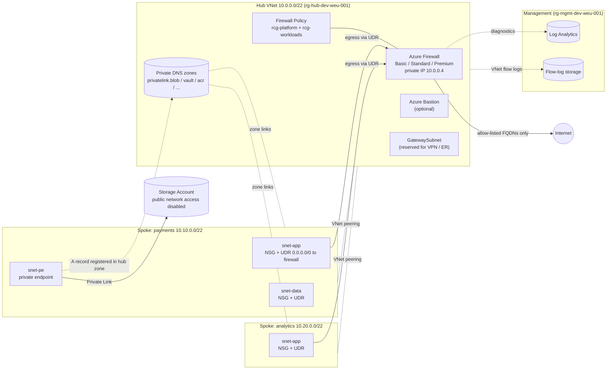

# Azure Landing Zone (Terraform): hub-and-spoke with spoke vending, policy-as-code and tests

[](https://github.com/rsk071216-stack/azure-landing-zone-terraform/actions/workflows/ci.yml)


A production-shaped Azure landing zone: a secured connectivity hub (Azure Firewall, central Private Link DNS,
optional Bastion), **spoke vending** where a new team network is one map entry, **policy-as-code** guardrails with
budget alerts, and a **unit test suite that runs on every pull request without an Azure account** by using
Terraform's native `terraform test` with a mocked `azurerm` provider.

---

## Contents

- [The problem this solves](#the-problem-this-solves)
- [Architecture](#architecture)
- [Features](#features)
- [What makes this different](#what-makes-this-different)
- [Repository layout](#repository-layout)
- [Module reference](#module-reference)
- [Add a new spoke](#add-a-new-spoke)
- [How the tests work](#how-the-tests-work)
- [What CI proves (and what it does not)](#what-ci-proves-and-what-it-does-not)
- [Deployment](#deployment)
- [Cost estimate](#cost-estimate)
- [Security and compliance mapping](#security-and-compliance-mapping)
- [Design decisions](#design-decisions)
- [How I can apply this to your organisation](#how-i-can-apply-this-to-your-organisation)
- [Roadmap](#roadmap)

---

## The problem this solves

Most Azure estates grow one portal click at a time. The result is familiar: VNets with overlapping address
ranges that can never be peered, virtual machines with public IPs, storage accounts open to the internet,
Private Endpoints that resolve differently depending on which network you ask from, no consistent tags, and a
monthly bill nobody can explain.

This repository replaces that with a repeatable foundation:

| Business concern | How it is handled |
|---|---|
| **Security** | All internet egress is forced through a central firewall with an allow-list. No public IPs on NICs, no public storage, private endpoints only. |
| **Compliance** | Azure Policy assignments are code: reviewed in pull requests, versioned, and reported in Azure Policy compliance. |
| **Repeatability** | Dev and prod are produced by the same modules; differences are explicit settings (firewall SKU, Bastion, retention). |
| **Speed of onboarding** | A new application team gets a fully wired, compliant network from a ~15-line pull request, in minutes instead of a ticket queue. |
| **Cost control** | Monthly budget with actual and forecast alerts, ingestion caps on non-production logging, cheap-by-default SKUs. |
| **Change safety** | Every pull request runs formatting, validation, linting, a security scan and 32 unit test runs; deployments are plan-then-approve with OIDC (no stored secrets). |

---

## Architecture



**Traffic rules in one sentence each**

- Spoke to internet: UDR `0.0.0.0/0 -> 10.0.0.4`, firewall allows platform FQDNs plus the spoke's own `egress_fqdns`, everything else is denied.
- Spoke to spoke: also via the firewall (peering is non-transitive); denied by default, so teams are isolated unless a rule says otherwise.
- Spoke to PaaS: through private endpoints only; the FQDN resolves to a private IP via the central DNS zone.
- Operators to VMs: Azure Bastion in the hub (no public IPs, no jump boxes).

### Spoke vending flow

```mermaid
flowchart LR
    pr["Pull request<br/>+1 entry in spokes.tf"] --> ci["CI: fmt, validate,<br/>terraform test, tflint, checkov"]
    ci --> review["Review and merge"]
    review --> plan["deploy workflow: plan<br/>(GitHub OIDC)"]
    plan --> gate{"Environment<br/>approval"}
    gate --> apply["apply"]
    apply --> out

    subgraph out["Created for the new spoke"]
        direction TB
        o1["Resource group, VNet, subnets"]
        o2["NSG per subnet, route table to firewall"]
        o3["Peering both directions"]
        o4["Links to every central DNS zone"]
        o5["Firewall egress rule for its CIDR"]
        o6["Flow logs + diagnostics"]
    end
```



---

## Features

| Area | Feature |
|---|---|
| Hub | Hub VNet with a deterministic subnet plan; Azure Firewall (Basic by default, Standard/Premium by variable) with Firewall Policy and rule collection groups; optional Azure Bastion; reserved `GatewaySubnet` |
| DNS | 10 centralised Private Link DNS zones (blob, dfs, file, queue, table, vault, ACR, SQL, Service Bus, Azure Monitor) linked to hub and every spoke; firewall DNS proxy automatically used on Standard/Premium |
| Spokes | Spoke vending via `for_each`; NSG per subnet with baseline deny; forced tunnelling UDR; BGP propagation off; default outbound access disabled; bidirectional peering; per-spoke firewall FQDN allow-list |
| Private endpoints | Reference Storage Account with public network access and shared keys disabled, reachable only through a private endpoint registered in the hub DNS zone |
| Observability | Central Log Analytics (Entra ID-only), diagnostic settings on firewall, public IPs, Bastion, VNets and NSGs; firewall logs in resource-specific tables; VNet flow logs with traffic analytics |
| Governance | 9 policy definitions (7 built-in, 2 custom) in 13 assignments, a documented policy exemption, tag inheritance with least-privilege remediation identity, monthly budget with forecast alert |
| Naming | CAF abbreviations, `<abbr>-<workload>-<env>-<region>-<instance>`, globally unique names seeded by subscription ID |
| Quality gates | `terraform fmt`, `validate` for every root and module, `terraform test` on two Terraform versions, TFLint with the azurerm ruleset, Checkov with SARIF upload, terraform-docs drift check, ShellCheck |
| Delivery | Manual plan/apply workflow with GitHub OIDC, plan artefact applied verbatim, GitHub environment approval gate |
| Supply chain | Every GitHub Action pinned by commit SHA, provider pinned exactly with a committed lock file, Dependabot with a 14-day cooldown |

---

## What makes this different

1. **Architecture contract tests without a cloud account.** 32 `terraform test` runs (52 assertions plus
   negative tests) prove that every spoke routes to the firewall, CIDRs never overlap, private endpoints have no
   public access, DNS records land in the central zone, tags and names follow the convention. They run in CI on
   every pull request, on forks, with zero credentials and zero cost.
2. **Guardrails fail the plan, not the audit.** Overlapping address spaces, subnets outside their spoke, missing
   required tags and invalid spoke names stop `terraform plan` with a readable message, before anything reaches Azure.
3. **Firewall IP is computed, not awaited.** Spokes build their routes in parallel with the 10+ minute firewall
   deployment, and the real next hop is visible in the plan ([ADR-0003](docs/adr/0003-deterministic-firewall-ip.md)).
4. **Least privilege for the pipeline itself.** OIDC federation per GitHub environment, and an ABAC-conditioned
   role that lets the pipeline grant exactly one role (Tag Contributor) and nothing else.
5. **Exceptions are code.** Every Checkov skip and every policy exemption carries a reason and points to an ADR.

---

## Repository layout

```text
.
├── environments/
│   ├── dev/                      # deployable root: Firewall Basic, no Bastion, 1 GB/day log cap
│   │   ├── main.tf               # calls modules/landing-zone with dev settings
│   │   ├── spokes.tf             # spoke vending map  <-- teams edit this file
│   │   ├── backend.hcl           # remote state settings (non-secret)
│   │   ├── providers.tf / versions.tf / variables.tf / outputs.tf
│   │   ├── .terraform.lock.hcl   # exact provider pin, committed
│   │   └── tests/config.tftest.hcl
│   └── prod/                     # same shape: Firewall Standard (zonal), Bastion Standard, 90-day retention
├── modules/
│   ├── landing-zone/             # composition: naming + management + hub + spokes + governance
│   ├── naming/                   # CAF naming, pure functions, no provider
│   ├── management/               # Log Analytics, flow-log storage, Network Watcher (optional)
│   ├── hub/                      # VNet, Firewall + Policy, Bastion, Private DNS, diagnostics
│   ├── spoke/                    # spoke vending unit
│   └── governance/               # Azure Policy (built-in + custom), exemption, budget
│       (each module: README.md generated by terraform-docs, tests/*.tftest.hcl where relevant)
├── tests/mocks/azurerm.tfmock.hcl  # shared mock data for the azurerm provider
├── scripts/
│   ├── bootstrap-state.sh        # keyless, versioned remote state storage
│   └── setup-oidc.sh             # Entra app + federated credentials + least-privilege roles
├── docs/adr/                     # architecture decision records
├── .github/workflows/ci.yml      # credential-free quality gates
├── .github/workflows/deploy.yml  # manual plan/apply with OIDC and approval
├── .tflint.hcl  .terraform-docs.yml  .github/dependabot.yml
└── README.md
```

---

## Module reference

Full input/output tables are generated by terraform-docs in each module README.

| Module | Key inputs | Key outputs |
|---|---|---|
| [`landing-zone`](modules/landing-zone) | `environment`, `location`, `subscription_id`, `tags`, `hub`, `spokes`, `management`, `governance` | `hub`, `spokes`, `private_dns_zone_ids`, `log_analytics_workspace_id`, `resource_names`, `policy_assignment_ids` |
| [`naming`](modules/naming) | `workload`, `environment`, `location`, `instance`, `unique_seed` | `names`, `suffix`, `region_code`, `abbreviations` |
| [`management`](modules/management) | `names`, `log_retention_days`, `log_daily_quota_gb`, `enable_vnet_flow_logs`, `network_watcher` | `log_analytics_workspace_id`, `flow_log_settings`, `resource_group_id` |
| [`hub`](modules/hub) | `address_space`, `firewall {sku_tier, zones, threat_intel_mode, idps_mode}`, `bastion`, `private_dns_zones`, `spoke_egress_rules` | `firewall_private_ip`, `private_dns_zone_ids`, `spoke_dns_servers`, `virtual_network_id`, `subnet_prefixes` |
| [`spoke`](modules/spoke) | `address_space`, `subnets {address_prefix, private_endpoints, nsg_rules, delegation}`, `hub`, `private_dns_zone_ids`, `deploy_example_private_endpoint` | `virtual_network_id`, `subnet_ids`, `default_route`, `example_storage_account` |
| [`governance`](modules/governance) | `subscription_id`, `allowed_locations`, `required_tags`, `enforce`, effects, `central_dns_resource_group_id`, `budget` | `policy_assignment_ids`, `custom_policy_definition_ids`, `budget_id` |

---

## Add a new spoke

Add one entry to `environments/<env>/spokes.tf` and open a pull request:

```hcl
    hr = {
      address_space = "10.30.0.0/22"
      egress_fqdns  = ["api.workday.com"]   # optional: per-spoke firewall allow-list

      subnets = {
        app = { address_prefix = "10.30.0.0/24" }
        pe  = { address_prefix = "10.30.1.0/26", private_endpoints = true }
      }
    }
```

That is the whole change. On apply you get `rg-hr-dev-weu-001`, `vnet-hr-dev-weu-001`, two subnets each with its
own NSG, a route table sending `0.0.0.0/0` to the firewall, peering in both directions, links to all central DNS
zones, a firewall rule allowing `api.workday.com` from `10.30.0.0/22` only, flow logs and diagnostics.

If the range overlaps another spoke or the hub, or a subnet is outside `10.30.0.0/22`, the plan fails:

```text
Error: Invalid value for variable
  ...
Spoke address spaces must not overlap each other.
```

Keys are part of resource names: treat them as immutable (renaming a key recreates the spoke).

---

## How the tests work

`terraform test` executes `*.tftest.hcl` files. Each provider-backed suite starts with:

```hcl
mock_provider "azurerm" {
  source = "../../tests/mocks"   # realistic ARM IDs for mocked resources
}
```

Terraform loads the real `azurerm` 4.80.0 schema (so wrong argument names or types still fail) but never calls
Azure. Runs use `command = plan` to assert on planned values, `expect_failures` to prove guardrails reject bad
input, and one `command = apply` per suite to exercise the full graph against mocks.

| Suite | What it proves |
|---|---|
| `modules/landing-zone/tests` | Every spoke routes `0.0.0.0/0` to the firewall IP; firewall IP is `.4` of `AzureFirewallSubnet`; hub subnet plan; naming convention across all scopes; required tags; DNS proxy only on SKUs that support it; overlapping spokes, spoke-hub overlap, missing tags and bad spoke keys are rejected; full graph applies |
| `modules/spoke/tests` | Default route and BGP settings; NSG on every subnet with baseline deny; no default outbound access; storage public access off, shared keys off, TLS 1.2; private endpoint registers in the hub zone; bidirectional peering; tags; overlapping or out-of-range subnets rejected |
| `modules/governance/tests` | Exact set of baseline assignments; allowed locations; storage policy is Deny; DNS policy excludes only the hub; tag Deny + Modify per tag with managed identity; budget forecast alert; audit-only mode |
| `modules/naming/tests` | CAF pattern, storage account name rules, region fallback, invalid input rejected (no provider needed) |
| `environments/*/tests` | The real dev and prod configuration (not a fixture) honours the routing contract |

Run locally (Terraform >= 1.8):

```bash
cd modules/landing-zone
terraform init -backend=false
terraform test
```

Sample output:

```text
tests/landing_zone.tftest.hcl... in progress
  run "every_spoke_routes_internet_through_the_firewall"... pass
  run "hub_subnet_plan_is_deterministic"... pass
  run "naming_convention_is_followed"... pass
  run "required_tags_are_present"... pass
  run "dns_proxy_used_only_when_sku_supports_it"... pass
  run "standard_sku_switches_spokes_to_firewall_dns_proxy"... pass
  run "rejects_overlapping_spokes"... pass
  run "rejects_spoke_overlapping_hub"... pass
  run "rejects_missing_required_tag"... pass
  run "rejects_invalid_spoke_key"... pass
  run "full_landing_zone_applies_against_mocks"... pass
tests/landing_zone.tftest.hcl... tearing down
tests/landing_zone.tftest.hcl... pass

Success! 11 passed, 0 failed.
```

---

## What CI proves (and what it does not)

| Verified on every push, without Azure credentials | Requires a real subscription |
|---|---|
| HCL formatting, syntax and provider schema conformance (`fmt`, `validate`) | That Azure accepts every API call (quotas, regional SKU availability, feature registration) |
| Architectural invariants and guardrails (`terraform test` with mocks, Terraform 1.9.8 and 1.15.9) | Policy evaluation results and remediation tasks |
| Lint rules and azurerm-specific checks (TFLint) | Effective routes, DNS resolution and firewall logs at runtime |
| Static security findings (Checkov, reported to code scanning, soft fail) | Real cost |
| Module docs are current (terraform-docs), scripts are clean (ShellCheck) | RBAC propagation timing for the tag-inheritance identities |

The deploy workflow (`plan` against a subscription) is the integration layer. It is ready to use but has not been
run as part of this repository's public CI, because that would require storing access to a paid subscription.

---

## Deployment

**Prerequisites:** Azure CLI, Terraform >= 1.8, Owner (or User Access Administrator + Contributor) on the target
subscription for the one-time setup.

1. **Bootstrap remote state** (keyless storage, versioning, soft delete):

   ```bash
   az login
   SUBSCRIPTION_ID=<guid> STORAGE_ACCOUNT=sttfstate<unique> ./scripts/bootstrap-state.sh
   ```

   Put the printed values into `environments/dev/backend.hcl` and `environments/prod/backend.hcl`.

2. **Create the pipeline identity with OIDC** (no client secret):

   ```bash
   SUBSCRIPTION_ID=<guid> GITHUB_REPO=<owner>/<repo> STATE_STORAGE_ID=<state account resource id> ./scripts/setup-oidc.sh
   ```

   Add `AZURE_CLIENT_ID`, `AZURE_TENANT_ID`, `AZURE_SUBSCRIPTION_ID` as repository secrets and create the GitHub
   environments `dev-plan`, `dev`, `prod-plan`, `prod`, with required reviewers on `dev` and `prod`.

3. **Deploy:** Actions > `deploy` > Run workflow > choose `dev` and `plan` (or `apply`). The apply job downloads
   the exact reviewed plan file and waits for environment approval.

   Or locally:

   ```bash
   cd environments/dev
   export TF_VAR_subscription_id=<guid>
   terraform init -backend-config=backend.hcl
   terraform plan -out tfplan
   terraform apply tfplan
   ```

4. **Post-deployment checklist**
   - `terraform output hub` firewall IP equals `az network firewall show ... --query "ipConfigurations[0].privateIPAddress"`.
   - From a VM in a spoke, `nslookup <storage>.blob.core.windows.net` returns a `10.x` address.
   - Azure Policy > Compliance shows the `alz-<env>-*` assignments.

**Destroy** (non-production):

```bash
cd environments/dev
terraform destroy
```

Policy assignments are removed with everything else. The state storage account from step 1 is intentionally not
managed by Terraform; delete its resource group manually if you no longer need it.

---

## Cost estimate

Indicative monthly list prices for West Europe, pay-as-you-go, 730 hours, light traffic. Always confirm with the
[Azure Pricing Calculator](https://azure.microsoft.com/pricing/calculator/).

| Component | Dev (defaults) | Prod (as configured) | Notes |
|---|---|---|---|
| Azure Firewall | ~USD 290 (Basic) | ~USD 915 (Standard) | Plus data processed: Basic ~USD 0.065/GB, Standard ~USD 0.016/GB |
| Azure Bastion | off | ~USD 210 (Standard, 2 units) | Basic ~USD 140 |
| Public IPs (Standard) | ~USD 7 (2) | ~USD 7 (2) | Firewall (+ management IP on Basic), Bastion |
| Log Analytics | up to ~USD 90 | usage based | Dev capped at 1 GB/day; roughly USD 2.3-3 per GB ingested |
| Private DNS zones | ~USD 5 | ~USD 5 | 10 zones at ~USD 0.50 |
| Private endpoints | ~USD 8 | ~USD 8 | ~USD 0.01/hour each plus ~USD 0.01/GB |
| VNet peering, flow logs, traffic analytics, storage | ~USD 5-20 | usage based | Peering ~USD 0.01/GB each way |
| **Approximate total** | **~USD 330-420** | **~USD 1,300+ before traffic** | Budgets in code: 400 (dev) and 3,000 (prod) |

The cheapest way to evaluate: deploy `dev`, run the checklist, then `terraform destroy` the same day (a few USD).

---

## Security and compliance mapping

| Risk | Control | Where |
|---|---|---|
| Data exfiltration through public PaaS endpoints | Storage public network access **Deny** policy; private endpoints; storage `public_network_access_enabled = false` | `governance`, `spoke` |
| Workloads exposed directly to the internet | Built-in **Deny** for public IPs on NICs; NSG baseline `deny-internet-inbound`; Bastion for admin access | `governance`, `spoke`, `hub` |
| Uncontrolled egress / C2 traffic | UDR `0.0.0.0/0` to firewall, default outbound access disabled, FQDN allow-list, threat intelligence (Deny on Standard+) | `spoke`, `hub` |
| On-premises routes bypassing inspection | BGP route propagation disabled on spoke route tables | `spoke` |
| Split-brain Private Link DNS | Central zones + custom **Deny** policy for `privatelink*` zones outside the hub | `hub`, `governance` |
| Lateral movement between teams | Spoke-to-spoke traffic transits the firewall and is denied by default | `hub` |
| Missing ownership and cost allocation | Required tags **Deny** on resource groups + **Modify** inheritance; plan-time tag check | `governance`, `landing-zone` |
| Data residency | Allowed locations for resources and resource groups | `governance` |
| Blind spots during incidents | Diagnostic settings everywhere, **AuditIfNotExists** policy, VNet flow logs + traffic analytics | `hub`, `spoke`, `governance` |
| Unfiltered subnets | Custom policy: subnets must have an NSG (Audit, see ADR-0005) | `governance` |
| Credential leakage | OIDC federation, no client secrets, storage shared keys and Log Analytics local auth disabled | `scripts`, workflows, modules |
| Runaway spend | Monthly budget: 80% / 100% actual and 100% forecast alerts; dev log ingestion cap | `governance`, `management` |
| Compromised CI dependency | Actions pinned by SHA, exact provider pin and lock file, Dependabot cooldown | `.github` |

These controls map naturally to Microsoft cloud security benchmark areas NS (network security), DP (data
protection), LT (logging and threat detection), IM (identity management) and AM (asset management).

---

## Design decisions

| ADR | Decision |
|---|---|
| [0001](docs/adr/0001-plain-azurerm-over-avm.md) | Plain `azurerm` resources instead of Azure Verified Modules (testability with mocks, single provider) |
| [0002](docs/adr/0002-spoke-vending-map.md) | Spoke vending through one map; spokes own both peering directions |
| [0003](docs/adr/0003-deterministic-firewall-ip.md) | Firewall private IP computed as `.4` of `AzureFirewallSubnet` |
| [0004](docs/adr/0004-security-baseline-scope.md) | Security baseline scope; Basic in dev, Standard in prod; what is deliberately out of scope |
| [0005](docs/adr/0005-policy-effects-and-exemptions.md) | Policy effects, enforcement mode and exemptions |
| [0006](docs/adr/0006-native-tests-with-mock-providers.md) | `terraform test` with mock providers as the primary test layer |
| [0007](docs/adr/0007-central-private-dns.md) | Central Private Link DNS and DNS proxy behaviour |

---

## How I can apply this to your organisation

- **Greenfield:** stand up a hub, governance baseline and your first spokes in days, with your address plan,
  regions, naming and tagging standards encoded and tested.
- **Brownfield:** start governance in `enforce = false` (report-only) to measure the gap, import existing VNets
  into spokes, then switch policies to enforce one by one.
- **Platform team enablement:** hand application teams a self-service pull-request flow for new networks, with the
  guardrails enforced by CI and policy instead of by manual review.
- **Hybrid connectivity:** extend the reserved `GatewaySubnet` with VPN or ExpressRoute and add DNS Private
  Resolver for on-premises name resolution.
- **Audits:** the compliance mapping above and the ADRs give auditors a traceable answer to "how do you prevent X".

Typical engagement: discovery and address/identity design, landing zone deployment, CI/CD with OIDC, knowledge
transfer to your team.

---

## Roadmap

- [ ] Management group hierarchy and policy initiatives (policy set definitions) at management-group scope.
- [ ] Multi-subscription spoke vending (subscription per workload) with provider aliases.
- [ ] Azure DNS Private Resolver for hybrid resolution; VPN Gateway module for the reserved `GatewaySubnet`.
- [ ] Azure Monitor alert rules and a firewall workbook (KQL) for denied flows and SNAT usage.
- [ ] Integration test stage (`terraform test` with a real provider in a sandbox subscription, nightly).
- [ ] Evaluate Azure Verified Modules once 1.0 releases are available (ADR-0001).
- [ ] Customer-managed keys for storage and Log Analytics.

---

## License

[MIT](LICENSE) © Raees Khan
